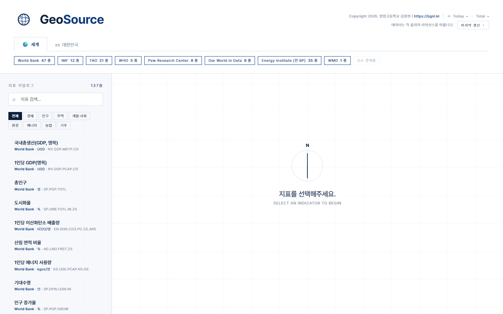

# 지오소스 (GeoSource)

세계 공식 통계를 한곳에 모은 데이터 허브입니다. World Bank, IMF, FAO, UN, KOSIS 같은 공식 기관의 통계를 같은 모양(표준 스키마)으로 바꿔 JSON으로 쌓아 두고, 웹 화면에서 지표를 골라 나라끼리 그래프로 견주고 CSV로 내려받을 수 있습니다. 지리 수업 자료를 만들거나 [지오테스터](https://geotester.bgnl.kr), [지오스탯아틀라스](https://geostatatlas.bgnl.kr) 같은 도구에 자료를 댈 때 씁니다.

바로가기: https://geosource.bgnl.kr



## 할 수 있는 일

- **지표 고르기**: 세계와 대한민국 두 갈래에서 출처별, 분야별(경제, 인구, 무역, 개발과 사회, 환경, 에너지, 농업, 기후)로 지표를 거르고 검색합니다.
- **나라 견주기**: 나라를 여러 개 고르고 연도 범위를 정해 꺾은선, 막대, 원 그래프로 봅니다. 「전체 선택」도 됩니다.
- **지표 연산**: 두 지표의 나누기, 빼기, 곱하기, 더하기와 전년 대비 증감률, 기준 해를 100으로 둔 지수를 계산해 봅니다.
- **기후 평년값**: WMO 평년값으로 도시를 최대 6곳 골라 월별 기온과 강수량을 한 그래프에 견줍니다.
- **표와 내려받기**: 자료를 표로 보고 CSV(엑셀에서 한글이 깨지지 않게 BOM 포함)로 받습니다.
- **마지막 갱신**: 출처마다 언제 다시 받았는지 화면 위 「마지막 갱신」에서 봅니다.
- **매월 자동 갱신**: GitHub Actions가 매월 1일 새벽 3시(한국 시각)에 모든 출처를 다시 받아 바뀐 자료를 커밋합니다.
- **관리 화면(`/admin`)**: GitHub 토큰으로 로그인해 출처를 골라 바로 다시 받게 하고, 진행 상태를 지켜봅니다.

## 출처와 지표 수

2026년 11월 1일 자동 갱신 기준으로 지표 166개, 기록 약 87만 건입니다(`data/build-info.json`, WHO 제외).

| 출처 | 지표 | 받는 방법 | 라이선스 |
|---|---|---|---|
| World Bank 세계개발지표 | 47 | 공개 API | CC BY 4.0 |
| IMF 세계경제전망(WEO, DataMapper) | 12 | 공개 API | IMF Open Data |
| FAO FAOSTAT | 21 | 공개 묶음 zip(인증 없음) | CC BY-NC-SA 3.0 IGO |
| Energy Institute 세계 에너지 통계(옛 BP, Our World in Data 정리본) | 35 | 공개 CSV | CC BY 4.0 |
| UN 세계인구전망(WPP 2024) | 10 | 공개 묶음 CSV | CC BY 3.0 IGO |
| UNHCR 난민 통계 | 5 | 공개 API | CC BY 4.0 |
| UN SDG 지표 | 5 | 공개 API | UN 공개 자료(출처 표기) |
| Our World in Data(민주주의 지수, 인간 개발 지수, 종교 등) | 7 | 공개 CSV | CC BY 4.0 |
| Pew Research Center 종교 인구 비율 | 8 | 공개 CSV | 퍼블릭 도메인(Pew 출처 표기) |
| WMO 세계 기상 정보 서비스(WWIS) 기후 평년값 | 1(도시별 월평년값) | 공개 JSON | 회원국 기상청 자료(출처 표기) |
| KOSIS 국가통계포털(시도별) | 15 | OpenAPI(키 필요) | 공공누리 제1유형 |
| WHO 세계보건관측소(GHO) | 5 (11월 갱신에서 받지 못해 10월 자료가 남아 있음) | 공개 API | CC BY-NC-SA 3.0 IGO |

IEA 자료는 대부분 유료이고 다시 나눠 줄 수 없어 넣지 않았습니다(화면에 「준비중」으로만 보입니다). 모든 기록에 `license` 값을 붙여, 출처마다 쓸 수 있는 범위를 확인할 수 있게 합니다.

## 표준 스키마

모든 출처를 아래 모양 한 가지로 바꿉니다(`schema.py`).

```json
{
  "dataset_id": "wb_NY.GDP.MKTP.CD",
  "source": "World Bank",
  "indicator_code": "NY.GDP.MKTP.CD",
  "indicator_name_ko": "국내총생산(GDP, 명목)",
  "category": "economy",
  "unit": "USD",
  "country_iso3": "KOR",
  "country_name_ko": "대한민국",
  "region": "Eastern Asia",
  "year": 2023,
  "period_type": "annual",
  "value": 1712792000000,
  "license": "CC BY 4.0",
  "fetched_at": "2026-05-08T..."
}
```

- 나라 코드: ISO 3166-1 alpha-3
- 지역: UN M49
- 시간: ISO 8601
- 통화: ISO 4217
- 빈 값: 모두 `null`

## 실행하기

Python 3.11 이상. 표준 라이브러리 말고는 Pew 나라 이름 맞추기에 `pycountry` 하나를 씁니다.

```bash
pip install pycountry

python build.py                         # 모든 출처 다시 받기
python build.py --source worldbank      # 한 출처만
# 고를 수 있는 출처: worldbank, imf, fao, owid, ei_energy, pew, who,
#                    un_wpp, unhcr, un_sdg, wmo, kosis, all

python -m http.server 8000              # 화면 확인: http://localhost:8000
```

결과는 `data/{dataset_id}.json`, 지표 목록 `data/catalog.json`, 갱신 정보 `data/build-info.json`입니다.

환경 변수는 KOSIS에만 필요합니다: `KOSIS_API_KEY`. GitHub Actions에서는 저장소 Secrets에 같은 이름으로 넣습니다.

화면은 `index.html` 한 장이고 Vercel에 올려 둡니다. 조회수(Today, Total)는 `admin/viewership.gs` Apps Script 웹 앱이 구글 시트에 셉니다.

### 관리 화면에서 다시 받기

1. `/admin`에서 GitHub 토큰(이 저장소만, Contents와 Actions 읽기 쓰기 권한)으로 로그인합니다.
2. 출처를 골라 갱신 단추를 누르면 `repository_dispatch`(`build-data`)로 `.github/workflows/build-data.yml`이 돌아갑니다.
3. 워크플로가 `python build.py`를 돌리고 바뀐 `data/`를 커밋합니다. 관리 화면은 진행 상태를 5초마다 확인해 보여 줍니다.

워크플로는 GitHub Actions 탭에서 손으로도 돌릴 수 있습니다. 저장소 설정의 Workflow permissions는 「Read and write」여야 자동 커밋이 됩니다.

## 새 출처 붙이기

`adapters/base.py`의 `SourceAdapter`를 이어받아 세 메서드를 만들고 `adapters/__init__.py`와 `build.py`에 등록합니다.

```python
class NewAdapter(SourceAdapter):
    def list_indicators(self) -> list[IndicatorMeta]: ...
    def fetch(self, indicator_code, countries, year_range): ...
    def transform(self, raw, indicator) -> list[StandardRecord]: ...
```

## 파일 구성

```
index.html                 화면 (지표 목록, 그래프, 표, 기후 평년값)
favicon.svg                아이콘
schema.py                  표준 스키마 (StandardRecord, IndicatorMeta)
build.py                   어댑터를 불러 data/*.json 만들기
adapters/
  base.py                  어댑터 틀
  worldbank.py, imf.py, fao.py, owid.py, owid_energy.py, pew.py,
  who.py, un_wpp.py, unhcr.py, un_sdg.py, wmo.py, kosis.py
                           출처마다 한 파일
data/                      표준 스키마 JSON, catalog.json, build-info.json
admin/
  index.html               관리 화면 (GitHub 토큰으로 갱신 실행)
  viewership.gs            조회수 Apps Script
.github/workflows/build-data.yml   매월 자동 갱신과 관리 화면 갱신
CHANGELOG-2026-05-*.md     작업 기록
```

## 만든 사람

양정고등학교 지리교사 김용현  
문의: bgnlkim@gmail.com
